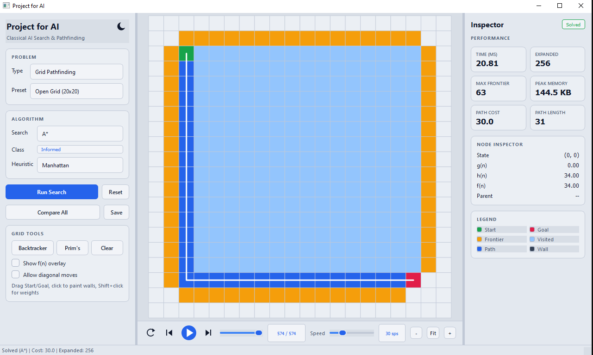
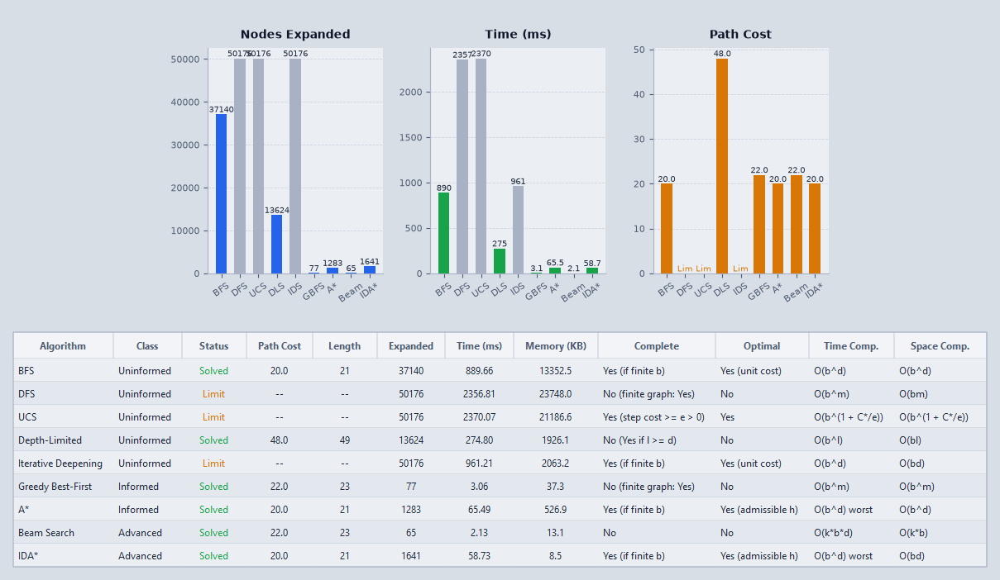
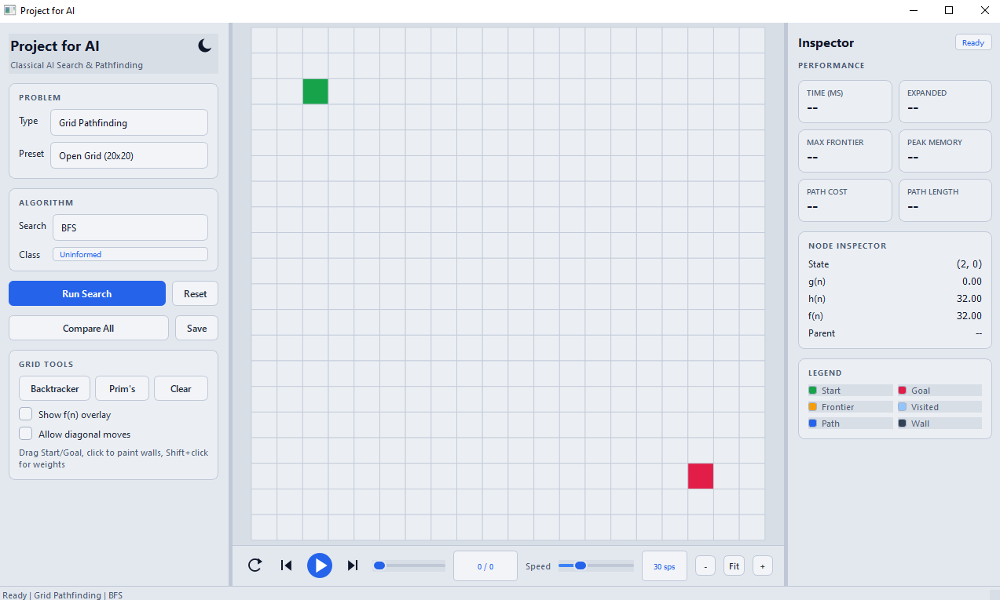
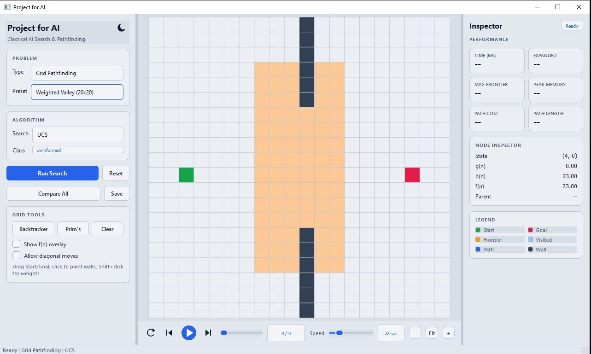
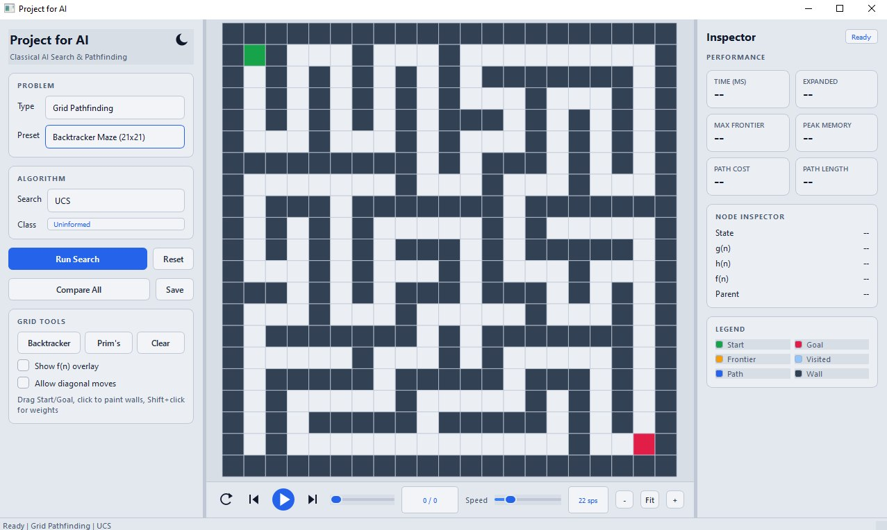
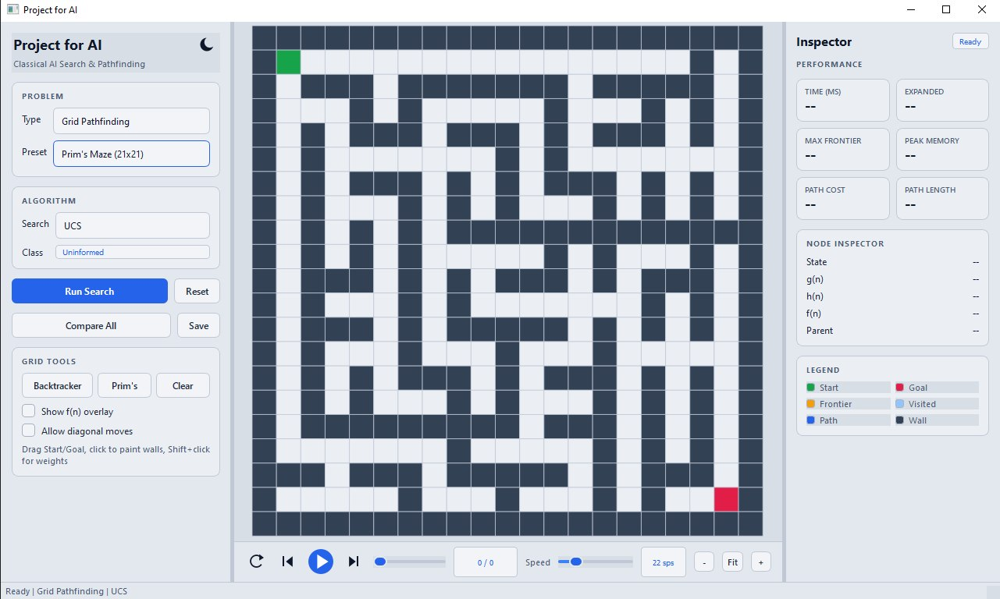
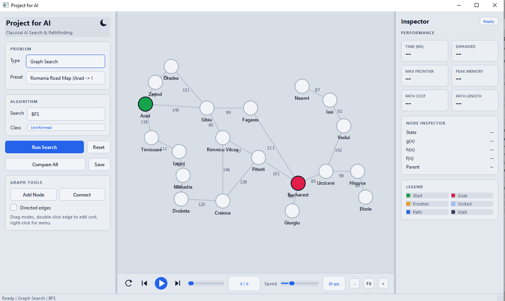
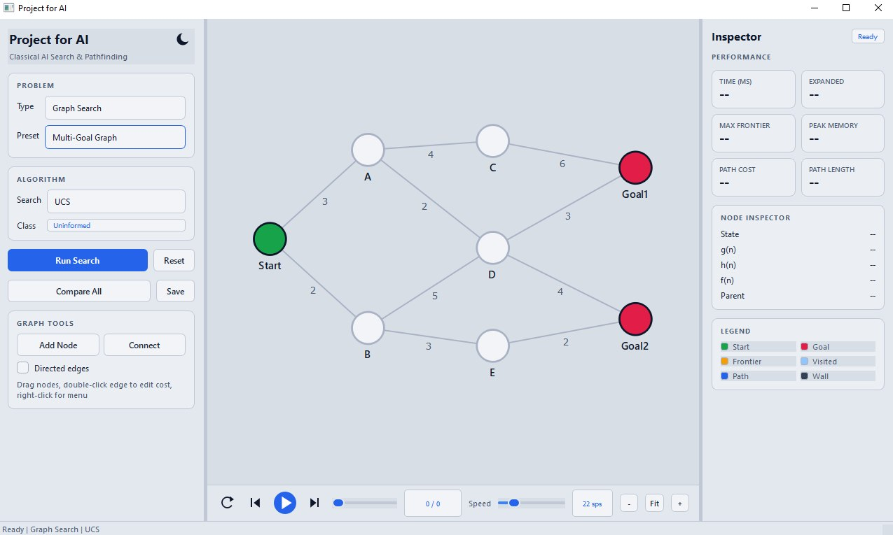
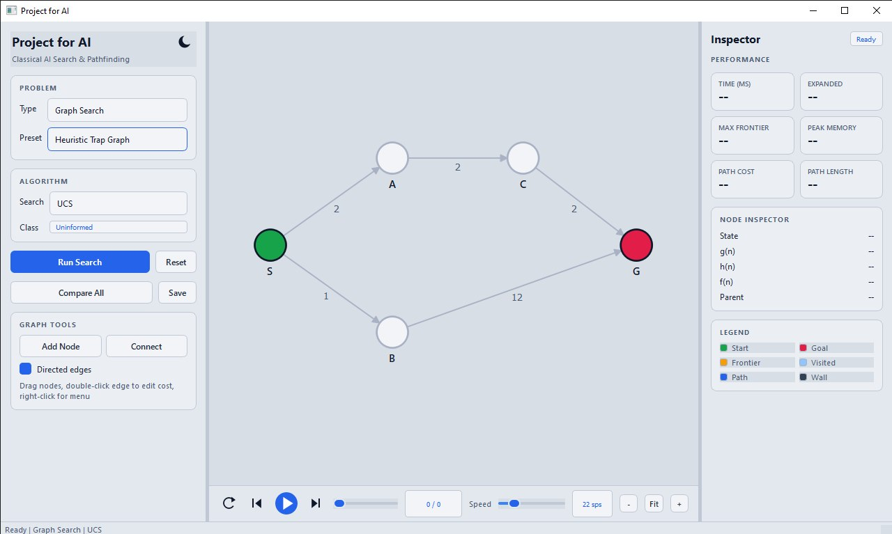
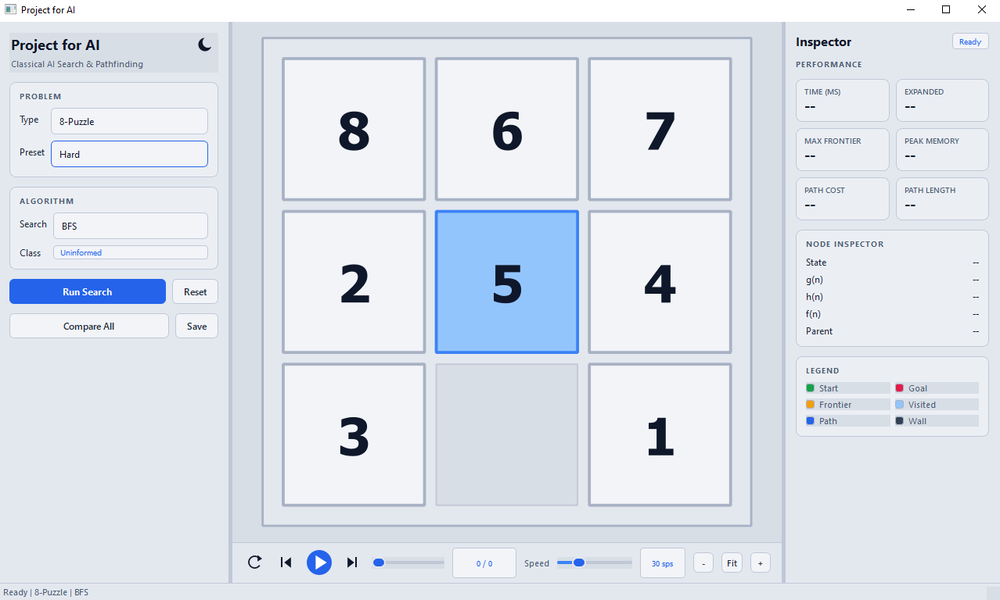

# Project for AI — Classical Search Algorithms Visualizer

<p align="center">
  <a href="https://github.com/Khweter/Project-for-AI-Course/releases/latest">
    
  </a>
  
  
  
</p>

An interactive **PyQt6** desktop application for visualizing, stepping through, and benchmarking classical Artificial Intelligence search algorithms across **Grid Pathfinding & Mazes**, **Weighted Graphs**, and the **8-Puzzle**.

Built on a decoupled architecture that runs search computation on background threads for accurate timing and memory profiling (`tracemalloc`), then drives smooth step-by-step playback with live `g(n)`, `h(n)`, and `f(n)` inspection.

<p align="center">
  
</p>

---

## Table of Contents

- [Key Features](#key-features)
- [Implemented Algorithms](#implemented-algorithms)
- [Supported Problem Domains & Presets](#supported-problem-domains--presets)
- [Screenshots](#screenshots)
- [Download & Quick Start](#download--quick-start)
- [Controls & Keyboard Shortcuts](#controls--keyboard-shortcuts)
- [Custom Scenario Format (JSON / TXT)](#custom-scenario-format-json--txt)
- [Project Architecture](#project-architecture)
- [Course & Team](#course--team)

---

## Key Features

- **Decoupled Search & Playback Engine:** Algorithms execute in background threads (`QThread`) with configurable timeout and node-expansion guards so the GUI stays responsive even on exponential searches.
- **Full Playback Control:** Play, pause, reset, step forward/backward, scrub through the search timeline, and adjust playback speed (`sps`) in real time.
- **Live Node Inspector:** Hover over states to inspect coordinates/labels, exact path cost `g(n)`, heuristic estimate `h(n)`, evaluation score `f(n)`, and parent links.
- **Interactive Problem Construction:** Drag Start/Goal markers, paint walls and weighted terrain, generate mazes (Recursive Backtracker & Prim's), or construct custom directed/undirected graphs interactively.
- **Multi-Algorithm Benchmark Suite:** Run all 9 algorithms side-by-side on the exact same problem instance, compare **Nodes Expanded**, **Execution Time (ms)**, **Peak Memory (KB)**, and **Path Cost** in charts and tables, and export comparison charts to **PNG**.
- **Light & Dark Theme Toggle:** Switch themes directly from the header bar.

---

## Implemented Algorithms

Every algorithm is implemented as a clean, standalone, textbook-faithful function following the 5-component state-space formulation (`initial_state`, `actions`, `result`, `goal_test`, `step_cost`).

| Algorithm                      | Category   | Frontier Structure           | Evaluation Function  | Complete                             | Optimal              | Source                                      |
| :----------------------------- | :--------- | :--------------------------- | :------------------- | :----------------------------------- | :------------------- | :------------------------------------------ |
| **Breadth-First Search (BFS)** | Uninformed | FIFO Queue                   | Depth                | Yes (finite $b$)                     | Yes (unit cost)      | [`uninformed.py`](algorithms/uninformed.py) |
| **Depth-First Search (DFS)**   | Uninformed | LIFO Stack                   | Depth (deepest)      | No (finite graph: Yes)               | No                   | [`uninformed.py`](algorithms/uninformed.py) |
| **Uniform Cost Search (UCS)**  | Uninformed | Priority Queue               | $f(n) = g(n)$        | Yes ($\text{step} \ge \epsilon > 0$) | Yes                  | [`uninformed.py`](algorithms/uninformed.py) |
| **Depth-Limited Search (DLS)** | Uninformed | LIFO Stack (limit $l$)       | Depth $\le l$        | Yes (if $l \ge d$)                   | No                   | [`uninformed.py`](algorithms/uninformed.py) |
| **Iterative Deepening (IDS)**  | Uninformed | Repeated DLS                 | Iterative depth      | Yes (finite $b$)                     | Yes (unit cost)      | [`uninformed.py`](algorithms/uninformed.py) |
| **Greedy Best-First (GBFS)**   | Informed   | Priority Queue               | $f(n) = h(n)$        | No (finite graph: Yes)               | No                   | [`informed.py`](algorithms/informed.py)     |
| **A\* Search**                 | Informed   | Priority Queue               | $f(n) = g(n) + h(n)$ | Yes (finite $b$)                     | Yes (admissible $h$) | [`informed.py`](algorithms/informed.py)     |
| **Beam Search**                | Advanced   | Bounded Priority Queue ($k$) | $f(n) = h(n)$        | No                                   | No                   | [`advanced.py`](algorithms/advanced.py)     |
| **IDA\***                      | Advanced   | Depth-First Thresholding     | $f(n) = g(n) + h(n)$ | Yes (finite $b$)                     | Yes (admissible $h$) | [`advanced.py`](algorithms/advanced.py)     |

---

## Supported Problem Domains & Presets

| Problem Type         | Built-in Presets                                                                                  | Available Heuristics                                                                    |
| :------------------- | :------------------------------------------------------------------------------------------------ | :-------------------------------------------------------------------------------------- |
| **Grid Pathfinding** | `Open Grid (20x20)`, `Backtracker Maze (21x21)`, `Prim's Maze (21x21)`, `Weighted Valley (20x20)` | `Manhattan`, `Euclidean`                                                                |
| **Graph Search**     | `Romania Road Map (Arad -> Bucharest)`, `Multi-Goal Graph`, `Heuristic Trap Graph`                | `Straight-Line (SLD)` (uses custom node heuristics if defined, otherwise Euclidean SLD) |
| **8-Puzzle**         | `Easy`, `Medium`, `Hard`, `Random Solvable`                                                       | `Manhattan`, `Misplaced Tiles`                                                          |

---

## Screenshots

### 1. Multi-Algorithm Benchmark & Charts

<p align="center">
  
</p>

### 2. Grid Pathfinding & Maze Presets

|                            Open Grid (`20x20`)                             |                                  Weighted Valley (`20x20`)                                  |
| :------------------------------------------------------------------------: | :-----------------------------------------------------------------------------------------: |
|  |  |

|                                  Backtracker Maze (`21x21`)                                   |                               Prim's Maze (`21x21`)                                |
| :-------------------------------------------------------------------------------------------: | :--------------------------------------------------------------------------------: |
|  |  |

### 3. Graph Search Presets

<p align="center">
  <strong>Romania Road Map (Arad -> Bucharest)</strong><br>
  
</p>

|                                     Multi-Goal Graph                                     |                                       Heuristic Trap Graph                                       |
| :--------------------------------------------------------------------------------------: | :----------------------------------------------------------------------------------------------: |
|  |  |

### 4. 8-Puzzle Solver

<p align="center">
  
</p>

---

## Download & Quick Start

### Option 1: Standalone Windows Executable (Recommended)

No Python installation is required.

1. Open the [**Latest Release**](https://github.com/Khweter/Project-for-AI-Course/releases/latest) page.
2. Download `Project for AI.exe` from the **Assets** section.
3. Double-click to launch _(if Windows SmartScreen prompts for an unsigned executable, click **More info** -> **Run anyway**)_.

### Option 2: Run from Source

Requires **Python 3.10+** (verified on Python 3.15.2).

```bash
git clone [https://github.com/Khweter/Project-for-AI-Course.git](https://github.com/Khweter/Project-for-AI-Course.git)
cd Project-for-AI-Course

python -m venv .venv
.venv\Scripts\activate

pip install -r requirements.txt
python main.py
```

**Dependencies (`requirements.txt`):**

- `PyQt6 >= 6.5`
- `pyqtgraph >= 0.13`
- `matplotlib >= 3.7`

### Building the Windows Executable

To rebuild `dist\Project for AI.exe` locally using PyInstaller:

```cmd
pip install pyinstaller
build_exe.bat
```

---

## Controls & Keyboard Shortcuts

### Canvas Navigation (All Views)

| Action           | Input                                                                     |
| :--------------- | :------------------------------------------------------------------------ |
| Zoom In / Out    | `Mouse Wheel` (cursor-anchored, 0.25x – 10.0x) or `Ctrl + +` / `Ctrl + -` |
| Reset / Fit View | `Ctrl + 0` or **Fit** button                                              |
| Pan Canvas       | `Middle-Mouse Drag` or `Ctrl + Left-Click Drag`                           |

### Domain-Specific Interactions

- **Grid Pathfinding:**
  - `Left-Click & Drag` Start or Goal cells to reposition them.
  - `Left-Click & Drag` open or wall cells to paint/erase walls.
  - `Shift + Left-Click & Drag` to paint or clear weighted cells (cost `5.0`).
  - `Hover` over any cell to inspect State, `g(n)`, `h(n)`, `f(n)`, and Parent.
- **Graph Search:**
  - `Left-Click & Drag` any node to reposition it (edges and cost labels update live).
  - `Shift + Left-Click` source node then target node to add or edit an edge.
  - `Double-Click` an edge or weight label to edit its cost.
  - `Right-Click` a node, edge, or empty canvas for context actions (Add Node, Connect, Rename, Set Heuristic `h(n)`, Set Start/Goal, Delete).
- **8-Puzzle:**
  - `Left-Click` any tile adjacent to the blank slot to slide it interactively.

---

## Custom Scenario Format (JSON / TXT)

Scenarios can be saved to `.json` directly via the **Save** button in the control panel, and loaded via `problems/io_loader.py` (`load_scenario` supporting `.json` for Grid/Graph and `.txt` for ASCII grids).

**JSON Grid Example:**

```json
{
  "type": "grid",
  "rows": 4,
  "cols": 4,
  "start": [0, 0],
  "goals": [[3, 3]],
  "walls": [
    [1, 1],
    [1, 2]
  ],
  "weights": { "2,1": 5.0 },
  "allow_diagonal": false
}
```

**ASCII TXT Grid Example (`S` = Start, `G` = Goal, `#` = Wall, `.` = Open):**

```text
S..#
.##.
...G
```

---

## Project Architecture

```text
Project-for-AI-Course/
├── main.py                     # Application entry point
├── requirements.txt            # Python dependencies
├── build_exe.bat               # PyInstaller Windows build script
├── core/
│   ├── problem.py              # 5-component abstract State-Space Problem
│   ├── node.py                 # SearchNode (state, parent, action, g, h, f, depth)
│   ├── trace.py                # StepEvent & SearchResult for decoupled animation
│   └── metrics.py              # Execution timer & tracemalloc memory profiling
├── algorithms/
│   ├── uninformed.py           # BFS, DFS, UCS, DLS, IDS
│   ├── informed.py             # Greedy Best-First Search, A*
│   ├── advanced.py             # Beam Search, IDA*
│   └── registry.py             # Algorithm metadata & dispatcher
├── problems/
│   ├── grid_problem.py         # Grid pathfinding, weighted terrain, maze generators
│   ├── graph_problem.py        # Weighted graph & SLD heuristics
│   ├── puzzle_problem.py       # 8-Puzzle with solvability checks
│   └── io_loader.py            # JSON & ASCII TXT scenario loader/saver
├── presets/
│   └── scenarios.py            # Built-in mazes, Romania Road Map, and puzzles
├── ui/
│   ├── main_window.py          # Main application layout & background workers
│   ├── playback.py             # Step playback controller & timeline scrubber
│   ├── splash.py               # Startup splash screen
│   ├── theme.py                # Light/Dark QSS theme tokens
│   ├── canvas/
│   │   ├── base_view.py        # Zoomable & pannable QGraphicsView base
│   │   ├── grid_view.py        # Interactive grid & maze canvas
│   │   ├── graph_view.py       # Draggable node/edge graph editor & visualizer
│   │   └── puzzle_view.py      # Sliding-tile 8-Puzzle canvas
│   └── widgets/
│       ├── control_panel.py    # Problem, algorithm & parameter controls
│       ├── metrics_panel.py    # Live KPI cards & node inspector
│       ├── compare_dialog.py   # Multi-algorithm benchmark & chart export
│       └── spinbox.py          # Custom styled numeric input
└── assets/
    └── images/                 # Application screenshots for documentation
```

---

## Course & Team

Developed for the **Artificial Intelligence ** course — **Faculty of Engineering, New Ismailia National University (NINU)**, Artificial Intelligence Engineering Program (AIEP), supervised by **Dr. Ahmed Magdy**.

### Team Members
| # | Name |
| :---: | :--- |
| 1 | Youssef Khweter |
| 2 | Hana Wael Abdelrahman |
| 3 | Mona Mohamed Kamal |
| 4 | Hala Mahmoud Fawzy |
| 5 | Zeina Mahmoud Fawzy |
| 6 | Malak Mohamed Saeed |
| 7 | Malak Adel Nabil |
| 8 | Yara Ayman Mohamed |
| 9 | Yassin Mostafa Kamal |
